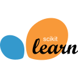
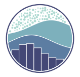

  

 

<blockquote>
  

    <em>사람들의 선택과 행동이 왜 일어났는지를 묻고, 
    데이터를 통해 그 이유와 더 나은 선택을 만드는 일에 관심이 있습니다.</em>
  

</blockquote>

 

## About

- **Education**: Theology, Philosophy - YonseiUniv
- **관심 직무**: 데이터 분석가 · 데이터 마케터 · 그로스 마케터
- **최근 관심**: 최신 AI 기술을 활용한 업무 효율화와 데이터 분석 자동화
- **교육**: 한국오라클 미래내일 일경험(프로젝트형) · 데이터 마케팅 직무부트캠프 수료

 

## Tech

<table>
  <tbody>
    <tr>
      <td width="125"><strong>Programming</strong></td>
      <td> Python</td>
    </tr>
    <tr>
      <td><strong>SQL</strong></td>
      <td> MySQL&nbsp;&nbsp;  PostgreSQL&nbsp;&nbsp;  Oracle</td>
    </tr>
    <tr>
      <td><strong>Data</strong></td>
      <td> pandas&nbsp;&nbsp;  GeoPandas&nbsp;&nbsp;  NumPy&nbsp;&nbsp;  SciPy&nbsp;&nbsp;  scikit-learn</td>
    </tr>
    <tr>
      <td><strong>Visualization</strong></td>
      <td> Matplotlib&nbsp;&nbsp;  Seaborn</td>
    </tr>
    <tr>
      <td><strong>Agent AI</strong></td>
      <td> Codex</td>
    </tr>
  </tbody>
</table>

 

## Projects

<table>
  <thead>
    <tr>
      <th width="160">프로젝트명</th>
      <th width="270">프로젝트 소개</th>
      <th width="230">결과물</th>
      <th width="170">역할</th>
    </tr>
  </thead>
  <tbody>
    <tr>
      <td valign="top"><a href="https://github.com/JHPark-kor/Culture-Gap-Analysis"><strong>문화예술 이용·접근성 분석</strong></a></td>
      <td valign="top">기초문화예술 관람의향의 관련 요인과 서울시 고령층의 문화 접근 취약권역을 분석한 프로젝트입니다.</td>
      <td align="center" valign="top">
         
        <a href="https://jhpark-kor.github.io/CULTURE_GAP/">대시보드 보기</a>
      </td>
      <td valign="top"><strong>팀장 · 분석 기획</strong> 문제 정의 · 원인 분석 프로젝트 총괄</td>
    </tr>
  </tbody>
</table>

 

## Participations

| 활동 | 주요 내용 |
| :--- | :--- |
| [AI/ML 스터디](https://github.com/JHPark-kor/ai-study) | 알고리즘 원리 학습 · 논문 및 사례 리뷰 · 데이터 분석 미니 프로젝트 |
| 연세대학교 KUSA | 봉사활동 · 환경정화 · 안전 캠페인 참여 |

 

## Certifications & Awards

**Certifications**

`ADsP` &nbsp; `SQLD` &nbsp; `OPIc AL` &nbsp; `빅데이터분석기사`

**Awards**

- 한경닷컴 × 고용노동부 **마케팅잡 3기 장려상**

 

## Contact

<table>
  <tbody>
    <tr>
      <td><strong>Mail</strong></td>
      <td><a href="mailto:yonsei201717@naver.com">yonsei201717@naver.com</a> <a href="mailto:pjh9804119@gmail.com">pjh9804119@gmail.com</a></td>
    </tr>
    <tr>
      <td><strong>Phone</strong></td>
      <td><a href="tel:+821084890830">010-8489-0830</a></td>
    </tr>
  </tbody>
</table>

 

## Git animals

  

