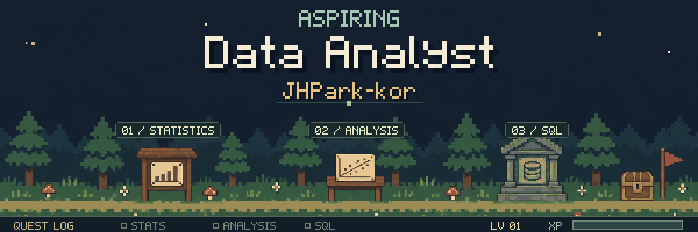
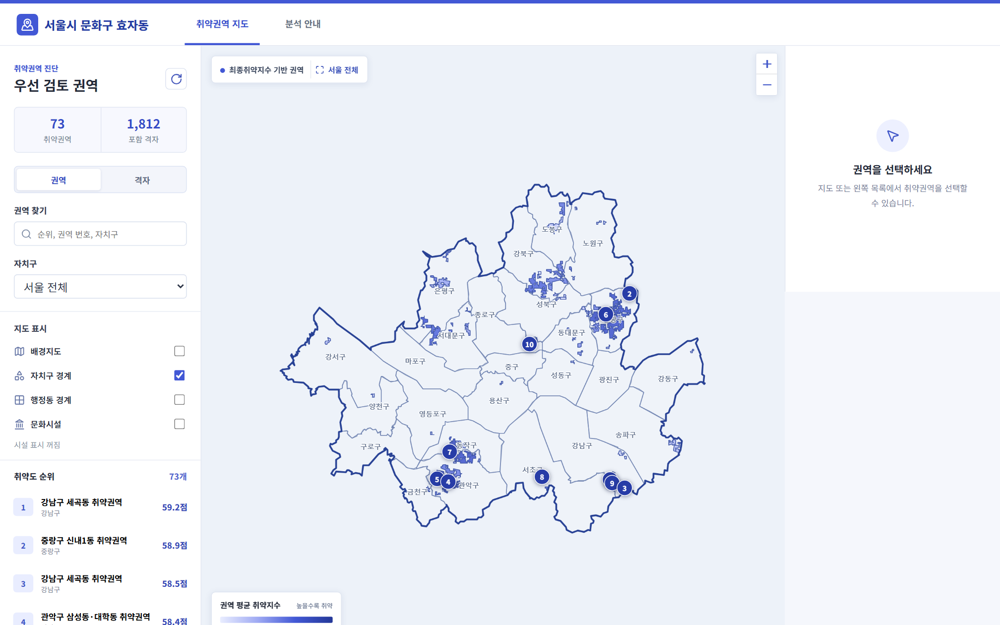

  

 

<h3 align="center">안녕하세요, 성장하는 데이터 분석가 박중현입니다.</h3>

  사람들의 선택과 행동이 왜 일어났는지를 묻고, 
  데이터를 통해 그 이유와 더 나은 선택을 만드는 일에 관심이 있습니다.

## About
저는
- Theology·Philosophy, Yonsei University 
- **배우는 것을 즐깁니다.** 새로운 지식, 기술의 변화, 산업 트렌드를 찾고, 활용하고, 분석합니다.
- **데이터를 바탕으로 원인을 찾고 해결책을 제시하는 것에 관심이 많습니다.** 고민과 실험을 통해 핵심적인 인과관계를 찾는 것을 좋아합니다. 
- **데이터를 수집·전처리·분석하고 결과를 쉽게 설명하는 역량을 쌓아왔습니다.**
- 현재는 앱 로그 데이터 분석, OTT 이후의 영화 산업, 저소득층의 문화소비 저조 원인 분석 프로젝트를 진행하고 있습니다.
- 최근에는 Agent AI를 활용해 단순 반복 업무를 효율적으로 처리하는 워크플로우와 앱을 설계하는 데 관심이 있습니다.

 

## Tech

<table>
  <tbody>
    <tr>
      <td width="125"><strong>Programming</strong></td>
      <td></td>
    </tr>
    <tr>
      <td width="125"><strong>SQL</strong></td>
      <td>  </td>
    </tr>
    <tr>
      <td width="125"><strong>Data</strong></td>
      <td>    </td>
    </tr>
    <tr>
      <td width="125"><strong>Visualization</strong></td>
      <td> </td>
    </tr>
    <tr>
      <td width="125"><strong>Agent AI</strong></td>
      <td></td>
    </tr>
  </tbody>
</table>

 

## Projects

<table>
  <thead>
    <tr>
      <th width="160">프로젝트명</th>
      <th width="270">프로젝트 소개</th>
      <th width="230">결과물</th>
      <th width="170">역할</th>
    </tr>
  </thead>
  <tbody>
    <tr>
      <td valign="top"><a href="https://github.com/JHPark-kor/Culture-Gap-Analysis"><strong>문화예술 이용·접근성 분석</strong></a></td>
      <td valign="top">기초문화예술 관람의향의 관련 요인과 서울시 고령층의 문화 접근 취약권역을 분석한 프로젝트입니다.</td>
      <td align="center" valign="top"> 
        <a href="https://jhpark-kor.github.io/CULTURE_GAP/">대시보드 보기</a></td>
      <td valign="top"><strong>팀장 · 분석 기획</strong> 문제 정의 · 원인 분석 프로젝트 총괄</td>
    </tr>
  </tbody>
</table>

 

## Participations

<table>
  <thead>
    <tr>
      <th width="280">활동</th>
      <th width="480">주요 내용</th>
    </tr>
  </thead>
  <tbody>
    <tr>
      <td><a href="https://github.com/JHPark-kor/ai-study">AI/ML 스터디</a></td>
      <td>알고리즘 원리 학습 · 논문 및 사례 리뷰 · 데이터 분석 미니 프로젝트</td>
    </tr>
    <tr>
      <td>하이테커 × ORACLE 데이터 분석 프로젝트</td>
      <td>문화누리카드 사업의 문제점 발굴 · 기초예술 소비 저조 원인 데이터 분석</td>
    </tr>
    <tr>
      <td>죽이야기 마케팅잡 프로젝트 3기</td>
      <td>식품 산업 트렌드 조사 · 고객 리뷰 스크래핑·텍스트 분석 · 마케팅 전략 기획</td>
    </tr>
    <tr>
      <td>코멘토 데이터 마케팅 부트캠프</td>
      <td>2030 소비 트렌드 분석 · 카드 상품 기획 · 채널 마케팅 전략 기획</td>
    </tr>
    <tr>
      <td>연세대학교 KUSA</td>
      <td>중앙 봉사 동아리 회장 역임 · 봉사 프로그램 기획·운영 · 환경정화·안전 캠페인</td>
    </tr>
  </tbody>
</table>

 

## Certifications & Awards

<table>
  <thead>
    <tr>
      <th width="80">구분</th>
      <th width="470">항목</th>
      <th width="180">연도</th>
    </tr>
  </thead>
  <tbody>
    <tr>
      <td rowspan="3" valign="top"><strong>자격증</strong></td>
      <td>ADsP (데이터분석 준전문가)</td>
      <td align="center">2026</td>
    </tr>
    <tr>
      <td>SQLD (SQL 개발자)</td>
      <td align="center">2026</td>
    </tr>
    <tr>
      <td>빅데이터분석기사</td>
      <td align="center">2026</td>
    </tr>
    <tr>
      <td><strong>어학</strong></td>
      <td>OPIc AL</td>
      <td align="center">2025</td>
    </tr>
    <tr>
      <td rowspan="4" valign="top"><strong>수상</strong></td>
      <td>연세대학교 성적 최우등상</td>
      <td align="center">2018</td>
    </tr>
    <tr>
      <td>연세대학교 성적 우수상</td>
      <td align="center">2020</td>
    </tr>
    <tr>
      <td>한경닷컴 × 고용노동부 마케팅잡 프로젝트 3기 장려상</td>
      <td align="center">2025</td>
    </tr>
    <tr>
      <td>연세대학교 성적 장학금 (진리 장학금)</td>
      <td align="center">2018 · 2019 · 2020 · 2021</td>
    </tr>
  </tbody>
</table>

 

## Contact

  &nbsp;
  &nbsp;
  

